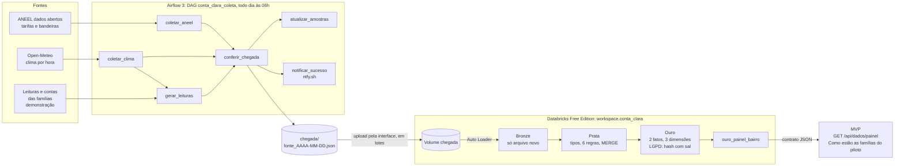

# Conta Clara: componente Dados

Pipeline de dados do **Conta Clara**, assistente de conta de luz para famílias de baixa renda
(Global Solution FIAP 2026.2, CitizenTech, 4ES).

Coleta com Airflow, camadas Bronze, Prata e Ouro no Databricks e publicação da **situação de cada bairro do piloto** no MVP:
https://contaclara-gs.azurewebsites.net.

## Ficha Técnica do MVP

| Campo | Conteúdo |
|---|---|
| **Nome do produto** | Conta Clara |
| **Cidadão e território** | Famílias de baixa renda, idosos que moram sozinhos e quem já teve corte ou conta muito acima do esperado. Piloto em bairros da zona sul de São Paulo (Capão Redondo, Jardim Ângela, Grajaú e Campo Limpo), área da ELETROPAULO (Enel SP). |
| **Problema, em uma frase** | A família não entende a própria conta de luz, só percebe o problema quando a fatura chega alta e não sabe contestar uma leitura estimada ou errada. |
| **Proposta de valor** | A família acompanha o consumo pelas leituras do medidor e recebe a contestação pronta quando a conta não bate. A organização parceira (CRAS, associação de moradores) vê por bairro quantas contas não batem e quanto há a contestar. |
| **Arquitetura: componentes** | MVP: página web e API FastAPI no Azure App Service. **Dados (este repositório):** Airflow 3 (coleta), Databricks Free Edition (Bronze, Prata, Ouro) e contrato JSON entregue ao MVP. |
| **Fontes de dados** | (A) ANEEL dados abertos: tarifas homologadas e bandeira tarifária. (B) Open-Meteo: temperatura e chuva por hora. (C) Leituras do medidor e contas de luz das famílias (sintéticas, de demonstração). |
| **Modelos de IA utilizados** | Nenhum neste componente. |
| **URL do MVP e repositórios** | MVP: https://contaclara-gs.azurewebsites.net. MVP: https://github.com/ph-tavares/conta-clara. Dados: https://github.com/ph-tavares/conta-clara-dados |
| **Indicadores de impacto** | Contas conferidas, contas divergentes, kWh cobrados a mais e valor a contestar por família (consulta Q4). |
| **ODS conectados** | ODS 7 (metas 7.1 e 7.3), ODS 10, ODS 11 (meta 11.1) e ODS 13. |

### Integrante

| Nome completo | RM |
|---|---|
| Pedro Henrique Pedrosa Tavares | RM97877 |

## Perguntas que o MVP responde com estes dados

| # | Pergunta | Consulta |
|---|---|---|
| Q1 | Quais contas não batem com o medidor, e quanto foi cobrado a mais? | `vw_q1_contas_divergentes` |
| Q2 | Quanto cada bairro gasta por dia e quanto deve dar a conta do mês com a tarifa e a bandeira vigentes? | `vw_q2_consumo_e_conta_por_bairro` |
| Q3 | O calor aumenta o consumo das famílias? | `vw_q3_calor_e_consumo` |
| Q4 | **Impacto:** quanto as contestações podem devolver, e o problema é cobrança por média ou erro de leitura? | `vw_q4_impacto_contestacoes` |
| Q5 | Quais perfis de família a organização parceira deve acompanhar primeiro? | `vw_q5_perfis_para_acompanhamento` |

## Arquitetura



O Databricks Free Edition não se conecta ao Airflow nem aceita conexão de fora. Por isso a entrada é o envio dos arquivos
ao Volume pela interface, e a saída para o MVP é um arquivo com formato fixado em contrato.

### Fontes

| Fonte | Origem | Formato | Frequência | Chave de API |
|---|---|---|---|---|
| Tarifas homologadas B1 da ELETROPAULO e bandeira do mês | Externa, ANEEL dados abertos (CKAN `datastore_search`) | JSON, listas `tarifas` e `bandeira_acionamento` | diária, 06h (vigente no dia de referência) | não exige |
| Temperatura, sensação térmica e chuva por hora | Externa, Open-Meteo (CC BY 4.0) | JSON, listas paralelas em `hourly` | diária, 06h (só o dia de referência) | não exige |
| Leituras do medidor e contas de luz | Gerador de demonstração no próprio DAG (`dags/simulador_medidores.py`) | JSON, listas `familias`, `leituras`, `contas` | diária, 06h | não se aplica |

Cada execução busca **só o dia de referência** (D-1). Com `catchup=True`, a primeira subida recupera sozinha os dias desde
02/11/2026 e cada arquivo tem conteúdo do seu próprio dia. As leituras são sintéticas (famílias `demo-NNN`, nome e
telefone fictícios) e determinísticas: reexecutar o mesmo dia gera o mesmo arquivo. O consumo simulado usa a temperatura
máxima real do dia (Open-Meteo), e o gerador inclui de propósito erros para a Prata barrar: leitura duplicada, valor
negativo, família inexistente, foto com baixa confiança, conta inválida e um dígito errado corrigido no arquivo do dia seguinte.

### Camadas

| Camada | Tabelas | O que acontece |
|---|---|---|
| Bronze | `bronze_clima`, `bronze_aneel`, `bronze_leituras`, `bronze_controle_cargas` | Auto Loader com checkpoint: uma linha por arquivo, JSON bruto. Só entra arquivo novo. |
| Prata | `prata_familia`, `prata_leitura`, `prata_conta`, `prata_clima_hora`, `prata_tarifa`, `prata_bandeira`, `prata_qualidade`, `prata_rejeitados` | Tipos e domínios, 6 regras de qualidade com contagem, quarentena e MERGE pela chave. |
| Ouro | `fato_leitura`, `fato_conta`, `dim_familia`, `dim_data`, `dim_tarifa`, `ouro_painel_bairro` | Modelo estrela, família pseudonimizada e a tabela que o MVP consome. |

### LGPD

- Na Ouro, a família vira `id_familia_hash` (SHA-256 com sal). Nome, telefone e número de moradores não entram (só a faixa).
- O sal é digitado no widget `salt_hash` do notebook 03 e não fica no repositório.
- O MVP recebe só totais por bairro (`ouro_painel_bairro`), sem nenhuma linha por família.
- Fotos do medidor nunca entram no lakehouse: chega só o número lido.
- As amostras do repositório mascaram nome e telefone (`***`), mesmo sendo fictícios.
- A pasta `chegada/` e o `variables.json` estão no `.gitignore`.

### Contrato com o MVP

O notebook 05 exporta `ouro_painel_bairro` no formato de [`contrato/ouro_painel_bairro.schema.json`](contrato/ouro_painel_bairro.schema.json).
O arquivo entra no repositório do MVP em `app/dados/ouro_painel_bairro.json`, passa pelo pipeline de deploy e é servido em
`GET /api/dados/painel`. A página mostra os dados na seção **Como estão as famílias do piloto**.

## Estrutura do repositório

```
dags/conta_clara_coleta.py          DAG do Airflow (coleta diária das três fontes)
dags/simulador_medidores.py         leituras e contas de demonstração (determinísticas por dia)
databricks/00_preparar_ambiente.sql esquema e Volumes
databricks/01_bronze_auto_loader.py Bronze incremental
databricks/02_prata_tratamento_merge.py  Prata: tipos, regras de qualidade, MERGE
databricks/03_ouro_modelo_dimensional.py Ouro: fatos, dimensões, LGPD, painel do MVP
databricks/04_consultas_mvp.sql     as cinco consultas SQL
databricks/05_exportar_para_mvp.py  exporta o painel para o MVP
contrato/                           formato do arquivo entregue ao MVP
amostras/                           um pouco de cada fonte (gerado pelo DAG)
relatorio/                          relatório em PDF
docker-compose.yml                  Airflow 3 local
variables.exemplo.json              modelo das Variables do Airflow (sem segredo)
```

MongoDB não foi usado: as três fontes são lidas direto pelo lakehouse.

## Como reproduzir

Pré-requisitos: Docker com Compose v2 e uma conta no [Databricks Free Edition](https://www.databricks.com/learn/free-edition).

### 1. Coleta no Airflow

```bash
git clone https://github.com/ph-tavares/conta-clara-dados.git && cd conta-clara-dados
echo "AIRFLOW_UID=$(id -u)" > .env       # só no Linux; no Windows e no macOS não precisa
docker compose up -d                      # Airflow em http://localhost:8080 (leva 1 a 2 minutos)
```

Configure as Variables (as fontes não exigem chave; o único segredo é a URL do tópico de notificação):

```bash
cp variables.exemplo.json variables.json   # edite: coloque o seu tópico do ntfy.sh
docker compose cp variables.json airflow:/tmp/variables.json
docker compose exec airflow airflow variables import /tmp/variables.json
```

Também dá para criar pela tela, em **Admin > Variables**. Sem a `ntfy_topic_secret`, a notificação sai só no log.

Na lista de DAGs, ative o `conta_clara_coleta`. Ele roda todo dia às 06h e, por ter `catchup`, recupera sozinho os
dias desde 02/11/2026 (uma execução por dia, uma de cada vez). Cada execução grava três arquivos, com o dia de referência (D-1) no nome:

```
chegada/clima/clima_2026-11-14.json
chegada/aneel/aneel_2026-11-14.json
chegada/leituras/leituras_2026-11-14.json
```

### 2. Databricks: primeiro lote

1. Importe a pasta `databricks/` no workspace (**Workspace > Create > Git folder** com a URL deste repositório, ou
   **Import** de um .zip com os arquivos).
2. Rode `00_preparar_ambiente`.
3. No **Catalog**, abra `workspace > conta_clara > chegada`, crie as pastas `clima`, `aneel` e `leituras` e envie
   (**Upload to this volume**) os arquivos dos primeiros dias, cada um na pasta da sua fonte.
4. Rode `01_bronze_auto_loader`. Rode de novo, sem enviar nada: `arquivos_novos` fica 0.
5. Rode `02_prata_tratamento_merge`.

### 3. Lotes seguintes

1. Envie ao Volume só os arquivos dos dias seguintes.
2. Rode `01_bronze_auto_loader`: só os arquivos novos entram.
3. Rode `02_prata_tratamento_merge`: o MERGE insere o que é novo e atualiza o que mudou (correções de leitura e recadastros).

### 4. Ouro, consultas e exportação

1. Rode `03_ouro_modelo_dimensional`. Antes, preencha o widget `salt_hash` com um texto secreto de 16 ou mais caracteres.
2. Rode `04_consultas_mvp`.
3. Rode `05_exportar_para_mvp` e baixe do Volume `entrega` o arquivo `ouro_painel_bairro.json`.
4. Copie `ouro_painel_bairro.json` para `app/dados/` no repositório do MVP e faça o push: o pipeline publica e a seção
   **Como estão as famílias do piloto** passa a mostrar os dados.

## Limites conhecidos

- As leituras e contas são de **demonstração** (`origem = sintetico`, identificada em todas as camadas). Os números do
  painel mostram o pipeline funcionando, não a realidade do bairro.
- O valor a contestar usa TUSD + TE sem impostos: é uma estimativa conservadora; a conta real tem ICMS, PIS/COFINS e CIP.
- O consumo esperado é a mediana diária entre leituras do cidadão; família com menos de duas leituras não é conferida.
- A tarifa da Tarifa Social tem descontos por faixa de consumo; aqui foi usada a tarifa base da subclasse Baixa Renda.
